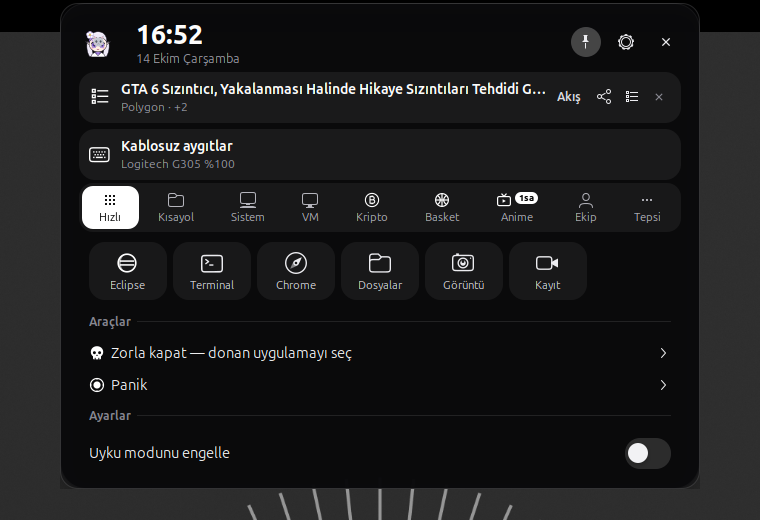
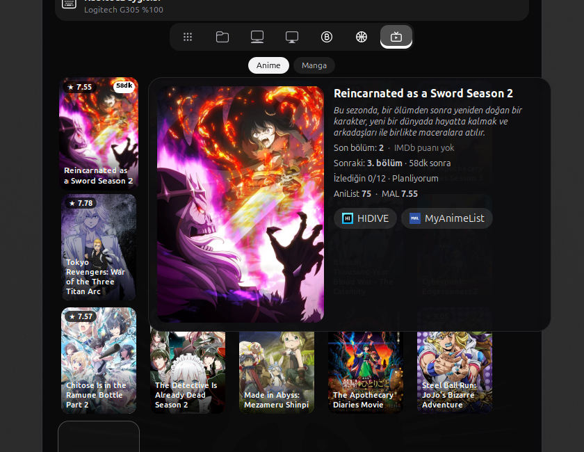
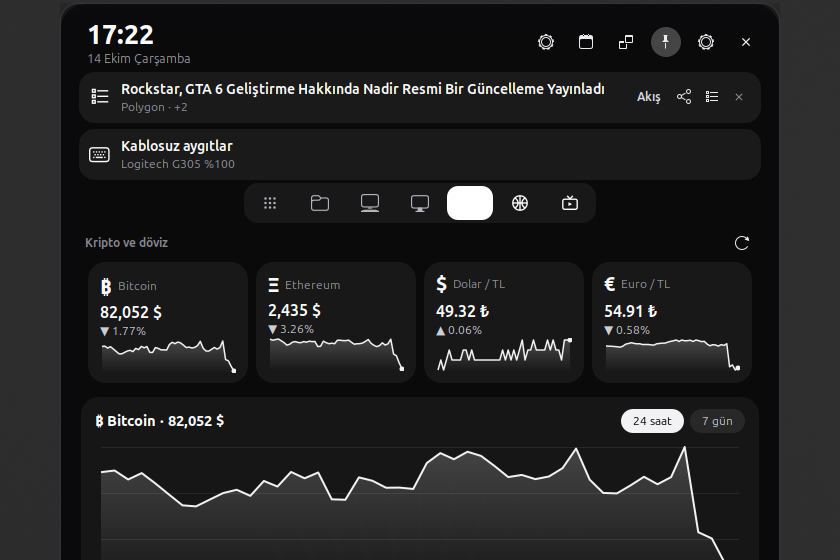
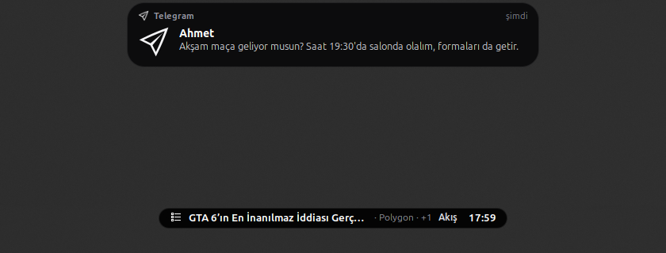
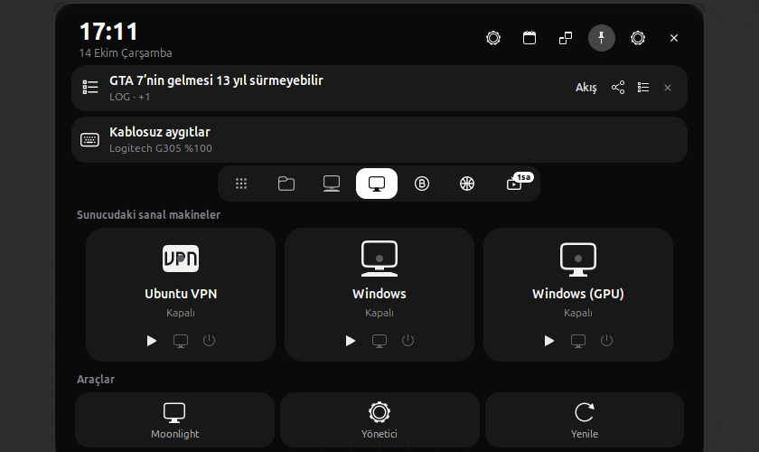

# FLUGEL Island

A Dynamic Island for **GNOME Shell 50**: the whole top bar becomes one black capsule in the middle of the screen
that morphs with a spring animation into live activities, notifications and a tabbed control card.
Black-and-white, dark theme, built for a laptop with a touchpad. Türkçe: [README.tr.md](README.tr.md)


| Card | Anime preview | Crypto |
|---|---|---|
|  |  |  |

| Notification from the island | Virtual machines |
|---|---|
|  |  |

## What it does
- **Only the island in the top bar.** Clock, battery, Quick Settings, calendar, tray icons, Activities and
  workspaces live inside it; Super+S, Super+V and the volume/brightness popups keep working.
- **Four states:** idle capsule (workspaces, server dot, clock, battery) → compact live activity → split with
  a second bubble → expanded card. Width, height and corner radius move together on one damped spring;
  content cross-fades; "Reduce animations" is respected.
- **Live activities** (priority order, each can be switched off): screen recording/mic/camera, notifications,
  panic mode, server alerts, GPU VM running, media (cover + controls), my referee matches and live scores,
  anime episodes, big crypto moves, volume/brightness, charging, wireless keyboard/mouse, a news watch word.
- **Notifications** open as an animated banner from the island instead of GNOME's banner.
- **Inspired by [Atoll](https://github.com/Ebullioscopic/Atoll) (GPL-3.0, macOS; ideas only, code written for GNOME):** a media
  player with draggable progress, ±10 s, previous/next, output device, two-finger swipe and a live equalizer; a power
  panel (screen off, lock, suspend, log out, restart, shut down — GNOME's own confirmation dialogs); timer with a
  countdown in the capsule; clipboard history (memory only); color picker; download progress; Do Not Disturb
  indicator; weather in the card header (Open-Meteo); springy buttons and staggered card animations.
- **Notch mode (default):** windows use the whole screen; the island is built into the top edge as a black notch with
  curved fillets (like a MacBook) and stays visible in fullscreen too.
- **Games tab:** this month's PlayStation Plus games (Essential + Extra/Premium catalog, from the official PlayStation
  Blog), free games on Epic, PC deals, Steam sale/top sellers/new releases and a price search (Steam TR + CheapShark).
- **Feed tab:** the FLUGEL Akış news feed (for you, highlights, games, tech, anime…) with thumbnails and summaries.
- **Fullscreen and maximized apps:** in fullscreen the app shrinks just enough to sit below the island strip, so the
  island stays visible and covers nothing (input is mapped exactly); with a maximized window the strip takes the
  app's header color and the island looks built into the app. A notch mode is still available.
- **Card tabs:** Quick (pinned apps, force quit, panic, keep-awake, screenshot/recording), Shortcuts (icon grid +
  keyboard shortcuts), System (PC, battery, server), Virtual machines (cards with start/connect/graceful shutdown),
  Crypto (any Binance coin in a watchlist; 1 h to 1 y chart with hover crosshair, drag-to-measure, support/resistance
  marks and price alerts that fire in the capsule), Matches (Highlights, Football, Basketball, National teams,
  Derbies, My teams, Pinned, CS2; HLTV-style 0–5 stars, favorite teams on top; live CS2 round score in the capsule
  with the round winner highlighted), Anime & manga (covers with title and MAL score; click for details with the
  MyAnimeList synopsis, IMDb rating, legal streaming links), Notifications (the server's last 24 h, hover to expand,
  mute by category).
- **Window helpers:** picture-in-picture always opens bottom-left and remembers where you put it; "Add to desktop".
- **Dock:** hover magnification for Ubuntu Dock / Dash to Dock icons.
- **Touchpad:** two-finger scroll on the capsule switches workspaces.
- **Settings:** an 11-page Adwaita window (every key has a control, per-page reset, JSON import/export,
  automatic updates, language Türkçe/English).

## Requirements
GNOME Shell 50 (Wayland). The data tabs read JSON from small helper scripts (`ust-panel-veri`, `cs2-veri`, `vm`) that live in
the main [FLUGEL](https://github.com/gok8lp/flugel) repository and talk to a home server; without them the island,
live activities, notifications, PiP and shortcuts still work and the data tabs show "unavailable".

## Install
```bash
git clone https://github.com/gok8lp/flugel-island
cd flugel-island
./kur.sh          # copies to ~/.local/share/gnome-shell/extensions, compiles schema and translations
```
Then log out and back in (Wayland loads new extensions only at login).

## Develop
```bash
npm install
npm run lint      # eslint (gjs style)
npm test          # unit tests for the activity model
flugel-island@flugel/po/derle.sh --kontrol   # translations: extract, merge, compile, fail if missing
tests/altin/island-test.sh tests/altin/altin.sh  # 71 end-to-end checks in a headless GNOME Shell (virtual pointer/touchpad)
```

## Licence
GPL-3.0-or-later. Forked from hacksynth/gnome-dynamic-island (GPL-2.0-or-later) and HIMURAw/gnome-dynamic-island
(GPL-3.0) — see [THIRD_PARTY.md](THIRD_PARTY.md) for credits, data sources and trademarks.
